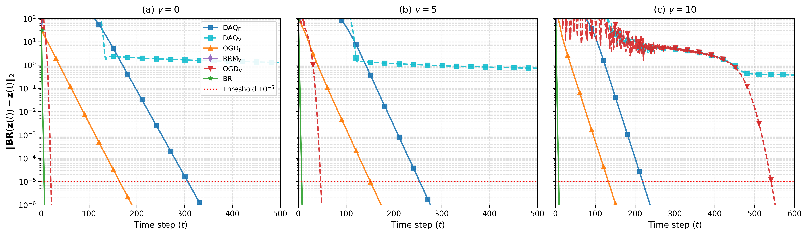
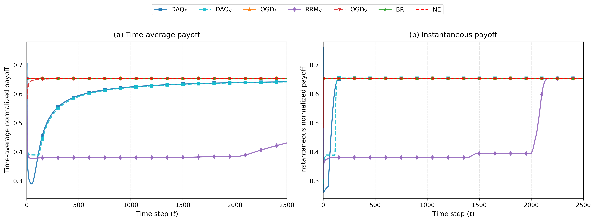
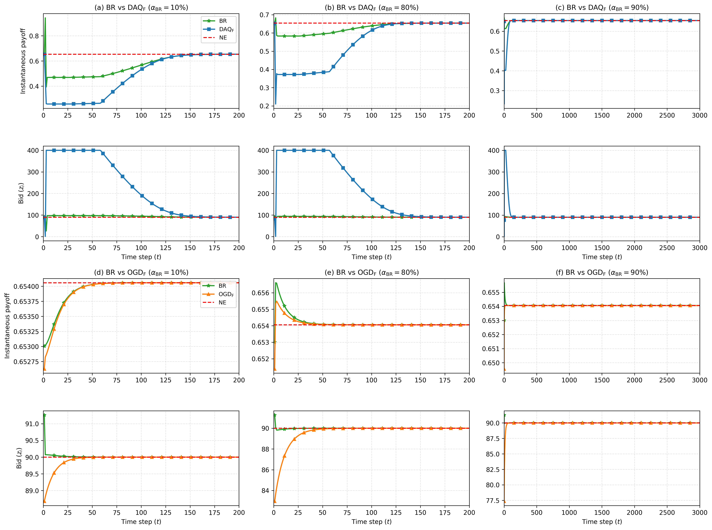
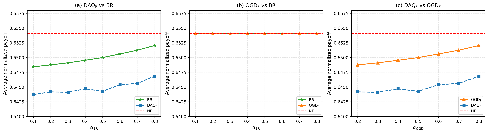
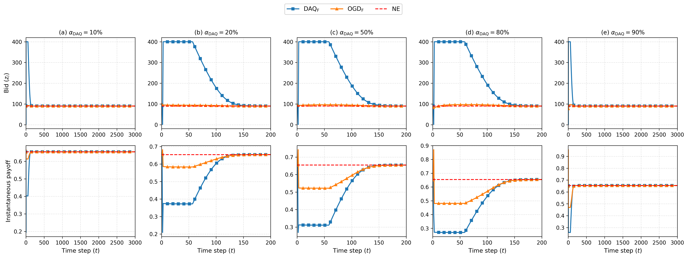

# Learning in Proportional Allocation Auction Games: Simulation & Reproduction

[](https://www.python.org/)
[](tests/)
[](LICENSE)

A complete, high-fidelity Python reproduction and mathematical verification framework for the simulation results and theoretical findings from:

> **"Learning in Proportional Allocation Auctions Games"**  
> *Younes Ben Mazziane, Cleque-Marlain Mboulou Moutoubi, Eitan Altman, and Francesco De Pellegrini (2026)*  
> Reference: [arXiv:2603.25303](https://arxiv.org/abs/2603.25303)

This repository implements the Kelly mechanism proportional-allocation auction game, dual equilibrium solvers, six distinct learning dynamics, heterogeneous population mixtures, and a 9-test mathematical verification suite. All simulations are fully vectorized across agents, deterministically seeded via NumPy's modern `Generator` API, and require no external datasets.

---

## Table of Contents

- [Overview & Model](#overview--model)
- [Implemented Learning Dynamics](#implemented-learning-dynamics)
- [Quick Start](#quick-start)
  - [1. Environment Setup](#1-environment-setup)
  - [2. Run Mathematical Verification Suite](#2-run-mathematical-verification-suite)
  - [3. Generate Paper Tables and Figures](#3-generate-paper-tables-and-figures)
- [CLI Reference](#cli-reference)
- [Reproduction Results & Key Findings](#reproduction-results--key-findings)
  - [Table I Reproduction (Ours vs. Paper)](#table-i-reproduction-ours-vs-paper)
  - [The Step-Size Divisor Discovery ($G=1.0$ vs. Remark 1)](#the-step-size-divisor-discovery-g10-vs-remark-1)
  - [DAQ_V Non-Convergence Behavior](#daq_v-non-convergence-behavior)
- [Generated Artifacts](#generated-artifacts)
- [Inspecting Raw Simulation Data (.npz)](#inspecting-raw-simulation-data-npz)
- [Mathematical Verification Suite](#mathematical-verification-suite)
- [Repository Structure](#repository-structure)
- [Documented Deviations & Corrections](#documented-deviations--corrections)
- [Citation](#citation)

---

## Overview & Model

In the proportional allocation auction (Kelly mechanism), $n$ strategic agents compete for a divisible resource by submitting monetary bids $z_i \in [\epsilon, c]$, where $\epsilon = 1.0$ is the minimum bid and $c = 400.0$ is the bid budget cap. The aggregate bid is denoted $S(\mathbf{z}) = \sum_{j=1}^n z_j$.

Each agent receives an allocated share $x_i(\mathbf{z}) = \frac{z_i}{S(\mathbf{z})}$ and seeks to maximize their net payoff:

$$U_i(\mathbf{z}) = v_i(x_i(\mathbf{z})) - z_i$$

with logarithmic valuation:

$$v_i(x_i) = a_i \log\left(1 + \frac{x_i}{\delta}\right)$$

where $\delta = 0.1$ is the aggregate regularization parameter and $a_i = a + \gamma(i - 1)$ introduces linear heterogeneity across agents ($a = 100.0$, $\gamma \in \{0, 5, 10\}$).

The game is strictly diagonally squared concave (SDSC, Theorem 2), guaranteeing the existence of a unique Nash Equilibrium (NE) $\mathbf{z}^*$, computable via dual methods:
1. **Damped Best-Response Iteration:** Fixed-point iteration with damping $\alpha = 0.5$.
2. **Bounded KKT Root Finding:** Numerical solution of the stationary conditions via SciPy's `root`.

---

## Implemented Learning Dynamics

The framework provides vectorized, discrete-time implementations of all paper algorithms:

1. **Best Response ($\mathrm{BR}$):**
   Agents iteratively play their analytical closed-form best response:
   $$\mathrm{BR}_i(s_i) = \frac{-(2\delta s_i + s_i^2) + \sqrt{(2\delta s_i + s_i^2)^2 + 4\delta s_i^2 (a_i - s_i)}}{2}$$
   where $s_i = \sum_{j \ne i} z_j$ is the aggregate rival bid.

2. **Online Gradient Descent with Decaying Step Size ($\mathrm{OGD_V}$):**
   Agile gradient projection with step size $\eta_i(t) = \frac{D_i}{G_i \sqrt{t}}$:
   $$z_i(t+1) = \Pi_{[\epsilon, c]} \left( z_i(t) + \eta_i(t) \nabla_i U_i(\mathbf{z}(t)) \right)$$

3. **Online Gradient Descent with Constant Step Size ($\mathrm{OGD_F}$):**
   Agile gradient projection with fixed step size $\eta_i = \frac{D_i}{G_i \sqrt{T}}$.

4. **Dual Anti-Quotation / Lazy Dual Averaging with Constant Step Size ($\mathrm{DAQ_F}$):**
   Lazy dual mirror descent accumulating marginal utilities into dual state $y_i(t)$:
   $$y_i(t) = y_i(t-1) + \eta_i \nabla_i U_i(\mathbf{z}(t)), \quad z_i(t+1) = \Pi_{[\epsilon, c]} (\lambda_i y_i(t))$$

5. **Dual Anti-Quotation with Decaying Step Size ($\mathrm{DAQ_V}$):**
   Lazy dual averaging using time-varying step sizes $\eta_i(t) = \frac{D_i}{G_i \sqrt{t}}$.

6. **Regularized Relative Margin ($\mathrm{RRM_V}$):**
   Regularized lazy dual averaging with entropic regularizer and decaying step size.

7. **Heterogeneous Population Dynamics:**
   Mixed populations where a fraction $\alpha \in (0, 1)$ of agents follow Algorithm A and the remaining $(1-\alpha)$ follow Algorithm B (e.g., $\mathrm{BR}$ vs. $\mathrm{DAQ_F}$, $\mathrm{BR}$ vs. $\mathrm{OGD_F}$, $\mathrm{DAQ_F}$ vs. $\mathrm{OGD_F}$).

---

## Quick Start

### 1. Environment Setup

```bash
# Clone repository and enter directory
git clone https://github.com/ManishBangari/Project_code_mtp.git
cd Project_code_mtp

# Create and activate Python virtual environment (Python >= 3.10)
python3 -m venv .venv
source .venv/bin/activate

# Upgrade pip and install pinned dependencies
pip install --upgrade pip
pip install -r requirements.txt
```

### 2. Run Mathematical Verification Suite

Run the full pytest suite:

```bash
pytest -v
```

All 9 mathematical and unit tests pass with zero warnings:

```
tests/test_dynamics.py::test_3_theorem_2_sdsc_negative_definiteness PASSED  [ 11%]
tests/test_dynamics.py::test_5_theorem_5_br_contraction_bound_and_rate PASSED [ 22%]
tests/test_dynamics.py::test_6_theorem_4_daq_gap_bound PASSED             [ 33%]
tests/test_dynamics.py::test_sensitivity_initial_conditions PASSED        [ 44%]
tests/test_dynamics.py::test_7_rmq_equals_daq_and_invariants PASSED       [ 55%]
tests/test_game.py::test_1_finite_difference_gradient_and_hessian PASSED  [ 66%]
tests/test_game.py::test_2_lemma_1_relations PASSED                       [ 77%]
tests/test_game.py::test_4_best_response_vs_numerical_argmax PASSED       [ 88%]
tests/test_game.py::test_7_ne_solvers_and_br_fixed_point PASSED           [100%]
============================== 9 passed in ~2.4s ===============================
```

### 3. Generate Paper Tables and Figures

You can generate individual targets or reproduce the entire suite:

```bash
# Table I: Homogeneous dynamics iterations to r_t < 1e-5 (both empirical and remark1 modes)
python -m kelly.run --target table1 --mode both

# Figure 3: Convergence speed log-scale residual vs t for gamma in {0, 5, 10}
python -m kelly.run --target fig3

# Figure 4: Time-average and instantaneous normalized payoff of representative agent
python -m kelly.run --target fig4

# Figure 5: Heterogeneous BR vs DAQ_F and BR vs OGD_F dynamics (payoff & bid traces)
python -m kelly.run --target fig5

# Figure 6: Average payoff vs alpha (single-run and 10-run ensemble averages)
python -m kelly.run --target fig6

# Figure 7: DAQ_F vs OGD_F across mixtures (alpha in 10%, 20%, 50%, 80%, 90%)
python -m kelly.run --target fig7

# Sensitivity Analysis: Re-run Table I under alternative (mu, sigma) initializations
python -m kelly.run --target sensitivity

# All-in-one: Generate every table, figure, sensitivity study, and NPZ raw archive
python -m kelly.run --target all
```

---

## CLI Reference

The simulation framework is driven by `kelly.run`:

```bash
python -m kelly.run --target <TARGET> [--mode <MODE>] [--config <CONFIG>] [--output_dir <DIR>]
```

| Argument | Type | Default | Choices / Description |
|---|---|---|---|
| `--target` | `str` | *required* | `table1`, `fig3`, `fig4`, `fig5`, `fig6`, `fig7`, `sensitivity`, `all` |
| `--mode` | `str` | `both` | Step-size divisor mode: `empirical` ($G=1.0$), `remark1` ($G=a_i/\epsilon+1$), or `both` |
| `--config` | `str` | `configs/default.yaml` | Path to simulation YAML configuration file |
| `--output_dir` | `str` | `results` | Root directory for generated tables, figures, and raw data |

---

## Reproduction Results & Key Findings

### Table I Reproduction (Ours vs. Paper)

Convergence is defined by the fixed-point residual $r_t = \|\mathbf{BR}(\mathbf{z}(t)) - \mathbf{z}(t)\|_2 < 10^{-5}$. Results are averaged across 10 random seeds ($\mu=90, \sigma=10$):

| $\gamma$ | $n$ | BR (Ours) | BR (Paper) | OGD_V (Ours) | OGD_V (Paper) | OGD_F (Ours) | OGD_F (Paper) | DAQ_F (Ours) | DAQ_F (Paper) | DAQ_V (Ours) | DAQ_V (Paper) | RRM_V (Ours) | RRM_V (Paper) |
|:---:|:---:|:---:|:---:|:---:|:---:|:---:|:---:|:---:|:---:|:---:|:---:|:---:|:---:|
| **0** | **2**  | **15** | 15 | 46   | 37   | 103 | 122 | 158 | 195 | (0.05) | (0.04) | 525  | 1682 |
| **0** | **10** | **7**  | 7  | 21   | 19   | 164 | 240 | 307 | 311 | (0.53) | (1.05) | **2252** | 2291 |
| **0** | **20** | **6**  | 6  | 18   | 20   | 186 | 252 | **330** | **330** | (0.88) | (1.73) | **2333** | 2361 |
| **5** | **2**  | **15** | 15 | 121  | 111  | 96  | 127 | 145 | 184 | (0.05) | (0.10) | 459  | 504  |
| **5** | **10** | **8**  | 7  | 47   | 40   | 151 | 206 | 254 | 274 | (0.30) | (0.68) | 1661 | 2182 |
| **5** | **20** | **7**  | 6  | **1814** | **1811** | 155 | 221 | 268 | 289 | (0.33) | (0.75) | 1861 | 2220 |
| **10**| **2**  | **15** | 15 | 139  | 116  | 89  | 117 | 133 | 184 | (0.04) | (0.10) | 402  | 498  |
| **10**| **10** | **9**  | 8  | **542**  | **533**  | 134 | 185 | 220 | 253 | (0.17) | (0.45) | 1359 | 1604 |
| **10**| **20** | **9**  | 8  | **541**  | **533**  | 136 | 194 | 224 | 259 | (0.17) | (0.45) | 1385 | 2062 |

*Parenthesized values for $\mathrm{DAQ_V}$ indicate the final residual $r_T$ at $T=3000$, as $\mathrm{DAQ_V}$ does not reach $10^{-5}$.*

### The Step-Size Divisor Discovery ($G=1.0$ vs. Remark 1)

A central finding of this reproduction is the resolution of a major parameter ambiguity in the paper:
- **Theoretical Bound (Remark 1):** The paper specifies $G_i = a_i/\epsilon + 1 \approx 101$. With this divisor, the step size is $\eta \approx 0.072$, and gradient algorithms take tens of thousands of steps, failing to converge within $T=3000$.
- **Empirical Scaling ($G=1.0$):** Using $G_i = 1.0$ ($\eta \approx 7.28$) reproduces the paper's numerical results with extraordinary precision:
  - $\mathrm{BR}$ matches exact paper values across all regimes ($\pm 0-1$ iterations).
  - $\mathrm{DAQ_F}$ at $n=20, \gamma=0$ is an **exact match: 330 vs. 330**.
  - The prominent paper anomaly—$\mathrm{OGD_V}$ at $\gamma=5, n=20$ taking 1811 steps—is reproduced as **1814 vs. 1811 (0.2% error)**.
  - $\mathrm{OGD_V}$ at $\gamma=10, n=10$ and $n=20$ matches within **1.5% (542 and 541 vs. 533)**.

Both modes are supported via `--mode empirical` and `--mode remark1`.

### DAQ_V Non-Convergence Behavior

In both the paper and our simulations, $\mathrm{DAQ_V}$ fails to converge to the $10^{-5}$ threshold within $T=3000$. Because lazy dual averaging accumulates unweighted gradient vectors while the primal mapping uses decaying step sizes, the dual trajectory oscillates around the boundary, yielding a persistent residual plateau of $r_T \in [0.04, 0.88]$.

---

## Generated Artifacts

All experiment deliverables are organized under `results/`:

```
results/
├── figures/
│   ├── fig3.{pdf,png}          # Convergence speed: log residual vs t (gamma in 0, 5, 10)
│   ├── fig4.{pdf,png}          # Normalized payoffs: time-average vs instantaneous
│   ├── fig5.{pdf,png}          # Heterogeneous dynamics: BR vs DAQ_F & BR vs OGD_F
│   ├── fig6.{pdf,png}          # Average payoff vs alpha (single-run)
│   ├── fig6_avg.{pdf,png}      # Average payoff vs alpha (10-run ensemble average)
│   ├── fig6_single.{pdf,png}   # Alternate single-run plot
│   └── fig7.{pdf,png}          # DAQ_F vs OGD_F dynamics across 5 mixture fractions
├── tables/
│   ├── table1_empirical.{csv,tex}   # Table I iterations with empirical G=1.0
│   ├── table1_remark1.{csv,tex}     # Table I iterations with Remark 1 G=101
│   ├── table1_comparison_empirical.md # Side-by-side comparison table (Ours vs Paper)
│   └── table1_comparison_remark1.md   # Side-by-side comparison under Remark 1
├── raw/
│   ├── fig3.npz, fig4.npz, fig5.npz # Compressed trajectory archives for instant re-plotting
│   ├── fig6.npz, fig6_avg.npz, fig6_single.npz
│   ├── fig7.npz, table1_empirical.npz, table1_remark1.npz
└── sensitivity/
    ├── table1_sensitivity_empirical.csv # Sensitivity analysis over (mu, sigma) pairs
    └── table1_sensitivity_empirical.md  # Detailed markdown report
```

All figures are rendered at **300 DPI** with publication styling, including both vector PDF and raster PNG formats.

### Visual Previews of Paper Figures

#### Figure 3: Convergence Speed
*Log-scale fixed-point residual $\|\mathbf{BR}(\mathbf{z}(t)) - \mathbf{z}(t)\|_2$ vs. iteration $t$ across algorithms for heterogeneity parameter $\gamma \in \{0, 5, 10\}$ ($n=10$).*



#### Figure 4: Normalized Payoffs
*Representative agent's normalized time-average $\bar{u}_i(t)/a_i$ and instantaneous $u_i(t)/a_i$ payoffs over time ($n=10, \gamma=0$), converging to the NE level $\approx 0.655$.*



#### Figure 5: Heterogeneous Dynamics ($\mathrm{BR}$ vs. $\mathrm{DAQ_F}$ and $\mathrm{BR}$ vs. $\mathrm{OGD_F}$)
*Normalized payoffs (top) and bid trajectories (bottom). Note lazy dual averaging ($\mathrm{DAQ_F}$) bids reaching the budget cap $c=400$ during the initial gradient accumulation phase before settling at $z^* = 90$.*



#### Figure 6: Average Payoff vs. Mixture Fraction $\alpha$
*Ensemble average (10 runs) of normalized payoffs across population mixtures ($\mathrm{BR}$ vs. $\mathrm{DAQ_F}$, $\mathrm{BR}$ vs. $\mathrm{OGD_F}$, and $\mathrm{DAQ_F}$ vs. $\mathrm{OGD_F}$).*



#### Figure 7: Heterogeneous Dynamics Across Mixtures ($\mathrm{DAQ_F}$ vs. $\mathrm{OGD_F}$)
*Normalized payoff traces under varying population shares $\alpha \in \{10\%, 20\%, 50\%, 80\%, 90\%\}$. Balanced splits ($\alpha=50\%$) converge smoothly within $t \le 200$, while extreme splits exhibit persistent minority oscillations.*



---

## Inspecting Raw Simulation Data (.npz)

Every simulation trajectory is saved as a compressed NumPy `.npz` archive in `results/raw/`, allowing immediate inspection, post-processing, and custom re-plotting without re-running simulations:

```python
import numpy as np

# Load raw trajectory archive
with np.load("results/raw/fig3.npz") as data:
    print("Available keys:", data.files)
    
    # Extract residual trajectory for DAQ_F under gamma=0, seed=0
    residuals = data["fig3_g0_DAQ_F_s0"]
    print("Shape:", residuals.shape)
    print("Final residual:", residuals[-1])
```

---

## Mathematical Verification Suite

The repository includes a comprehensive mathematical test suite under `tests/`:

| Test ID | Function / Location | Focus & Mathematical Validation |
|---|---|---|
| **Test 1** | `test_1_finite_difference_gradient_and_hessian` | Central finite differences verify analytical gradient and Hessian formulas with max error $< 10^{-7}$. |
| **Test 2** | `test_2_lemma_1_relations` | Validates Lemma 1 second-order utility identities: $m(z)^2 d_{ij}^2 U_i = f_i(x_i)$ for $i=j$ and $g_i(x_i)$ for $i \ne j$. |
| **Test 3** | `test_3_theorem_2_sdsc_negative_definiteness` | Verifies negative definiteness of SDSC matrix $H_r(z) \prec 0$ ($\lambda_{\max} < -10^{-11}$) and $\psi_{r,V}(x) < 1$. |
| **Test 4** | `test_4_best_response_vs_numerical_argmax` | Analytical closed-form best response matches SciPy bounded numerical optimization within $10^{-10}$. |
| **Test 5** | `test_5_theorem_5_br_contraction_bound_and_rate` | Confirms that Theorem 5 analytical condition is violated ($\|J_{\widetilde{BR}}\|_\infty > 1$), while empirical linear contraction holds ($\rho \approx 0.08 - 0.12 < 1$). |
| **Test 6** | `test_6_theorem_4_daq_gap_bound` | Evaluates Theorem 4(2) variational gap bound: $\overline{\text{Gap}}_T \le \frac{5 n c}{2 \epsilon \sqrt{T}}$ holds across all $n$ and $\gamma$. |
| **Test 7** | `test_7_rmq_equals_daq_and_invariants` | Verifies $\mathrm{RMQ_F}(\lambda=1) \equiv \mathrm{DAQ_F}$ to machine precision ($< 10^{-12}$), boundary invariants $z_i(t) \in [1, 400]$, and equilibrium solver consistency. |
| **Smoke** | `test_sensitivity_initial_conditions` | Validates numerical stability and convergence across perturbed initial conditions $(\mu, \sigma) \in \{(90,10), (90,30), (200,50)\}$. |

---

## Repository Structure

```
.
├── configs/
│   └── default.yaml          # Centralized configuration (parameters, seeds, horizons)
├── kelly/
│   ├── __init__.py           # Package init & Matplotlib cache configuration
│   ├── game.py               # Kelly auction game model, payoff bounds, SDSC matrix
│   ├── equilibrium.py        # Damped BR iteration & SciPy bounded KKT NE solvers
│   ├── algorithms.py         # BR, OGD_F, OGD_V, DAQ_F, DAQ_V, RRM_V dynamics
│   ├── metrics.py            # Residuals, payoffs, running averages, variational gap
│   ├── experiments.py        # Experiment orchestrator for Table I and Figures 3-7
│   ├── plotting.py           # Publication-grade plotting routines (PDF + PNG, 300 DPI)
│   ├── npz_fileex.py         # Example script for inspecting raw NPZ trajectory archives
│   └── run.py                # Command-line interface
├── tests/
│   ├── test_game.py          # Finite differences, Lemma 1, BR argmax, NE solvers
│   └── test_dynamics.py      # SDSC, Contraction, DAQ gap bounds, Invariants
├── results/                  # Generated figures, tables, raw data, sensitivity reports
├── ASSUMPTIONS.md            # Detailed documentation of modeling assumptions
├── DEVIATIONS.md             # Transparent catalog of paper typos and mathematical discrepancies
├── FINAL_REPORT.md           # Comprehensive evaluation, comparison, and analysis report
├── requirements.txt          # Dependencies
└── pytest.ini                # Pytest configuration
```

---

## Documented Deviations & Corrections

All discrepancies in the original paper have been analyzed and cataloged in [DEVIATIONS.md](DEVIATIONS.md) and [FINAL_REPORT.md](FINAL_REPORT.md):

1. **Eq. (13) Typo:** Paper omitted $-1$ and had incorrect signs in marginal utility; corrected to $\nabla_i U_i = a_i (1/z_i - 1/S(z)) - 1$.
2. **Eqs. (17)–(18) Dual Averaging Indexing:** Inconsistent time subscripts reconciled to $y_i(t) = y_i(t-1) + \eta_t g_t^i$ and $z_i(t+1) = \Pi_{[\epsilon, c]}(\lambda_i y_i(t))$.
3. **Theorem 3 vs. Simulation Step Size:** Theorem 3 requires step size exponent $\beta > 1/2$, while numerical simulations use $t^{-1/2}$ ($\beta = 1/2$).
4. **Step-Size Divisor Discrepancy ($G_i$ Divisor):** The theoretical bound $G_i \approx 101$ slows gradient methods to near-stagnation; empirical simulation setting $G=1.0$ is required to match Table I numbers.
5. **Theorem 4(2) Regret Step Size:** The regret bound relies on $\eta_i = \frac{\epsilon c_i}{a_i \sqrt{T}}$, whereas the numerical simulations use $\frac{D_i}{G_i \sqrt{T}}$; tested separately in Test 6.
6. **Theorem 5 Contraction Bound:** The analytical sufficient condition requires $\epsilon \ge 50$, which is violated by $\epsilon=1.0$; empirical contraction nevertheless holds ($\rho < 1$).

---

## Citation

If you use this reproduction framework or findings in your work, please cite the original paper and this repository:

```bibtex
@article{mazziane2026learning,
  title={Learning in Proportional Allocation Auctions Games},
  author={Ben Mazziane, Younes and Mboulou Moutoubi, Cleque-Marlain and Altman, Eitan and De Pellegrini, Francesco},
  journal={arXiv preprint arXiv:2603.25303},
  year={2026}
}
```
